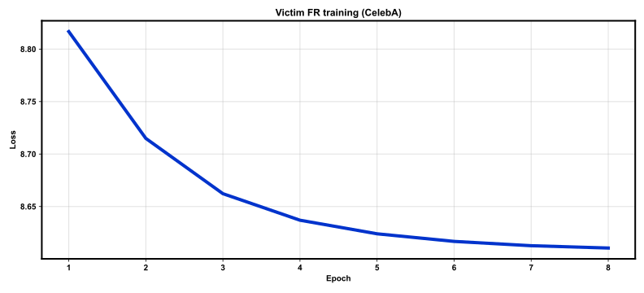
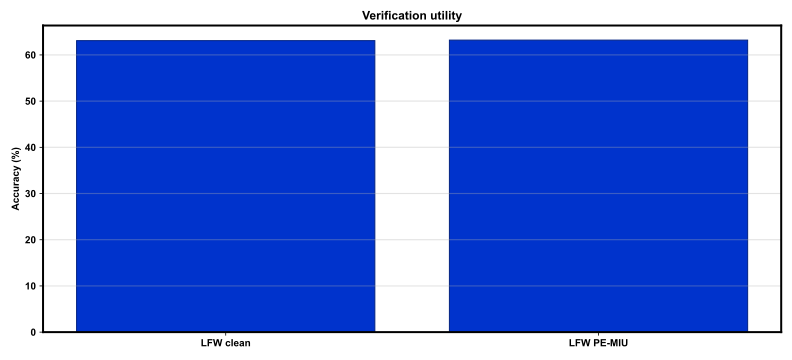
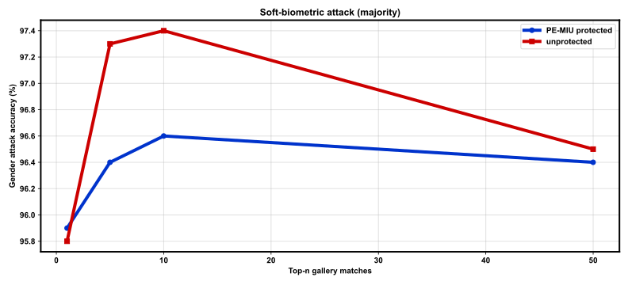

# REPORT: Soft-biometric privacy attack — full

**Protocol:** `full`  
**Victim privacy:** PE-MIU (block_size=16)  

## Verification utility

| Setting | Accuracy | EER | Pairs |
|---------|----------|-----|-------|
| LFW clean | 63.08% | 36.92% | 6000 |
| LFW PE-MIU | 63.20% | 36.80% | 6000 |

## Gender attack (CelebA subject-disjoint)

- Gallery: 2000 · Probe: 1000
- Reconstruct match: `True`

| Mode / n | 1 | 5 | 10 | 50 |
|----------|------|------|------|------|
| protected/majority | 95.9% | 96.4% | 96.6% | 96.4% |
| protected/average | 95.9% | 96.4% | 96.6% | 96.4% |
| protected/linear | 95.9% | 96.9% | 96.7% | 96.6% |
| protected/log | 95.9% | 96.9% | 96.7% | 96.6% |
| unprotected/majority | 95.8% | 97.3% | 97.4% | 96.5% |
| unprotected/average | 95.8% | 97.3% | 97.4% | 96.5% |
| unprotected/linear | 95.8% | 97.1% | 97.3% | 96.6% |
| unprotected/log | 95.8% | 97.1% | 97.3% | 96.7% |

## Training

- Epochs: 8
- Train images: 141610
- Identities: 7124
- Elapsed: 1049.07 s

## Figures







## Reproduce

```bash
bash scripts/smoke.sh
bash scripts/train_full.sh
```

## Notes

- PE-MIU from pterhoer/PrivacyPreservingFaceRecognition; attack per paper Alg.
- PFRNet victim omitted (weights unavailable); CelebA gallery/probe (D1).
